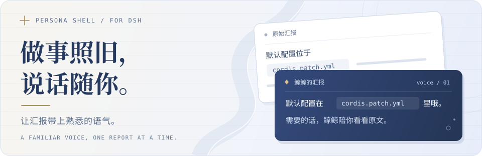
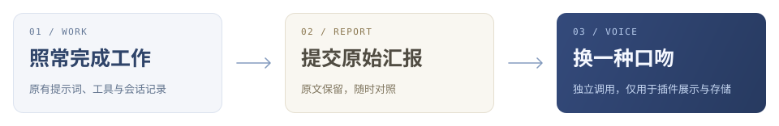

<p align="center">
  
</p>

<h1 align="center">dsh-persona-shell</h1>

<p align="center">给 DeepSeek Harness 的助手汇报换个口吻。</p>

<p align="center">
  <a href="https://github.com/deepseek-ai/deepseek-harness"></a>
  <a href="./LICENSE"></a>
  <a href="https://dsh-plugin.org/plugins/crisvollerei/dsh-persona-shell"></a>
</p>

<p align="center">
  <a href="#快速上手">快速上手</a> ·
  <a href="./docs/guide.md">使用指南</a> ·
  <a href="#文档">文档导航</a> ·
  <a href="./CHANGELOG.md">更新记录</a>
</p>

<p align="center">
  
</p>

助手照常使用自己的提示词和工具。等一段汇报提交后，persona-shell 再单独调用模型，按你选的人格换一种说法。

**人格版留在插件里，工作会话保留原文。** 下一步干活的助手，读到的仍是原始汇报。

## 换个口吻，保留原文

**助手的原始汇报**

> 默认配置位于 `cordis.patch.yml`，改写超时后会显示原文。

**你看到的鲸鲸版**

> 默认配置在 `cordis.patch.yml` 里哦，改写要是超时了，鲸鲸就把原文给你看。

<sub>仅示意口吻，不是固定模板；实际表达由人格卡和模型决定。</sub>

- **角色由你选。** 内置四个人格预设，也能编辑人格卡，或从一段人设提示词生成自己的预设。
- **原文随时看。** `origin` 打开原文对照；措辞变化达到阈值时，`※` 提供轻量原文预览。
- **过程也能转述。** 默认包含阶段汇报；可选地参考轻量运行信息补充一句，或在长时间静默时播报状态。
- **技术内容先保护。** 识别到的代码、路径、命令等先打码再回填；调用失败、超时或最终校验失败时显示原文。

<p align="center">
  
</p>

## 快速上手

需要支持插件管理的 **DSH Desktop 或 Web**，开发与验证基于 `0.2.1-rc.5`，兼容说明见[使用指南](./docs/guide.md#安装)。

**1. 安装插件**

在 **Plugins → Add plugin → Install a third-party plugin** 中填入 `dsh-persona-shell`，或使用命令行：

```bash
dsh plugin --profile <profile> add dsh-persona-shell
```

将 `<profile>` 换成你的配置名称。其他安装方式见[使用指南](./docs/guide.md#安装)。

**2. 启用并选择人格**

启用 bundle；若 DSH 提示重启，重启一次。打开 **设置 → 人格套壳**，选择喜欢的预设。

| 预设 | 口吻 |
| :--- | :--- |
| **大肥鱼（默认）** | 蓝发鲸鱼娘，自称「鲸鲸」，助手叫「小鲸鲸」。 |
| **大肥龙** | 管事大姐大风格的白龙娘，助手叫「小肥龙」。 |
| **Claude小姐** | 理性、克制，规矩感强的社区二创口吻。 |
| **鲸鲸（实验性）** | 转述助手「姐姐」的汇报，保留谁在做事的关系。 |

内置预设可编辑另存，原版始终保留。具体方法见[人格预设](./docs/guide.md#人格预设)。

**3. 照常开始对话**

有正文的汇报提交后，聊天区就会逐步显示人格版。会话标题栏的 **人格** 控制当前会话，`origin` 用来查看原文。

关闭阶段性输出改写可跳过带工具调用的步骤；严格只改最终汇报需配置 `trigger: report`。旁边的 **允许过程转述参考运行信息** 默认关闭；**静默状态播报** 也需手动开启。用到时再去[使用指南](./docs/guide.md)了解。

## 文档

按需要往下读：

- **[使用指南](./docs/guide.md)** — 安装、人格编辑、功能开关、原文对照与风格记忆。
- **[配置参考](./docs/configuration.md)** — 完整参数、默认值、生效顺序与部署选项。
- **[架构与边界](./docs/architecture.md)** — 两层隔离、运行信息统计、状态同步与兼容限制。
- **[开发指南](./docs/development.md)** — 源码导览、本地检查、可选集成测试与发布约定。
- **[后续计划](./docs/roadmap.md)** — 宠物联动与角色交互等尚未实现的方向。

## 使用前了解

> [!NOTE]
> 转述会额外调用所选模型，带来用量与等待；叙述文本也会发送给该模型提供方。
>
> 字面量保护和 `※` 都不等于语义核验。重要结论、条件与风险，请对照原文。
>
> 渲染不兼容或出现接管冲突时，插件保留官方显示。完整限制见[使用边界](./docs/architecture.md#使用边界)。

## 许可与素材

代码采用 **[MIT](./LICENSE)** 许可。角色预设来自社区二创，`icon.png` 为社区素材的裁剪版本，版权归原作者；代码许可不代表角色或图标素材授权。[角色来源与素材说明 →](./docs/guide.md#角色与素材)
