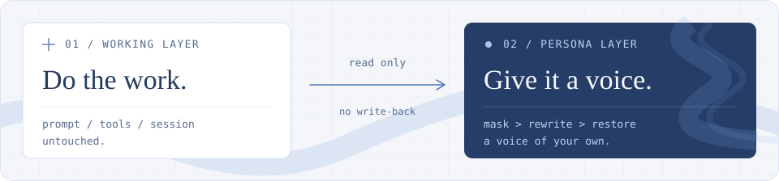

<p align="center">
  
</p>

<h1 align="center">dsh-persona-shell</h1>

<p align="center">
  <strong>做事照旧，说话随你。</strong><br>
  给 DeepSeek Harness 的助手汇报换个口吻。<br>
  人格留在表达层，工作提示词保持原样。
</p>

<p align="center">
  <a href="https://github.com/deepseek-ai/deepseek-harness"></a>
  <a href="./package.json"></a>
  <a href="./LICENSE"></a>
  <a href="https://dsh-plugin.org/plugins/crisvollerei/dsh-persona-shell"></a>
</p>

<p align="center">
  <a href="#安装">安装</a> ·
  <a href="#使用">使用</a> ·
  <a href="#两层之间的边界">工作原理</a> ·
  <a href="#使用边界">使用边界</a> ·
  <a href="#配置参考">配置参考</a> ·
  <a href="#开发">开发</a> ·
  <a href="./CHANGELOG.md">更新记录</a>
</p>

---

把人设写进 system prompt，能让角色立住，也让每个工作步骤都得带上它。persona-shell 选了另一条路：**让助手照常干活，等汇报提交后，再单独换一种说法。**

改写结果只留在插件存储和页面里，不写回工作会话。下一步干活的助手，读到的仍是原始汇报，而不是自己刚才的“人格版”。

## 换个口吻，保留原文

| 助手的原始汇报 | 你看到的鲸鲸版 |
| :--- | :--- |
| 默认配置位于 `cordis.patch.yml`，改写超时后会显示原文。 | 默认配置在 `cordis.patch.yml` 里哦，改写要是超时了，鲸鲸就把原文给你看。 |

<sub>仅示意口吻，不是固定模板；实际表达由人格卡和模型决定。</sub>

### 不只是换个称呼

| 能力 | 实际行为 |
| :--- | :--- |
| **阶段汇报也有角色感** | 默认改写每个有正文的助手步骤，包括工具调用前的简短叙述；也可只改每轮最终汇报。 |
| **先保护技术字面量** | 识别到的代码、路径、命令、URL、版本号先替换为 `[[n]]`，改写后原样回填。 |
| **边写边显示，失败回原文** | 改写逐段出现；最终校验失败、调用失败或超时，回落原文。 |
| **需要时再看原文** | `origin` 打开独立对照窗口；措辞变化较大时，`※` 提供轻量原文预览。 |
| **可选的静默播报** | 默认关闭。长时间没有正文时，可基于可观察活动额外生成带 `◈` 前缀的短播报。 |
| **预设与子代理分别控制** | 人格卡可编辑、可从提示词生成；子代理的过程与结论默认都不改写，可分别开启。 |

> [!NOTE]
> 套壳会额外调用模型，带来用量和等待；字面量保护也不是语义核验。渲染结构不兼容或遇到冲突时，插件保留官方显示，不强行套壳。详见[使用边界](#使用边界)。

## 安装

需要已支持插件管理的 **DSH Desktop 或 Web**。开发与验证基于 `0.2.1-rc.3`，其他版本的兼容性请以实际使用为准。

### 推荐：从 npm 安装

```bash
dsh plugin --profile <profile> add dsh-persona-shell
```

也可以在侧边栏 **Plugins → Add plugin** 中选择 **Install a third-party plugin**，填入包名 `dsh-persona-shell`。

安装后启用该 bundle；如果 DSH 提示重启，重启一次客户端。随后打开 **设置 → 人格套壳**，选择预设即可。

<details>
<summary><strong>其他安装方式：GitHub Release、Git 仓库或本地目录</strong></summary>

#### GitHub Release（Tarball）

从 [Releases](https://github.com/crisvollerei/dsh-persona-shell/releases) 下载当前版本的 `dsh-persona-shell-<version>.tgz`，然后在 **Plugins → Add plugin** 中选择 **Install a third-party plugin**，填入下载链接，例如：

```text
https://github.com/crisvollerei/dsh-persona-shell/releases/download/v0.4.6/dsh-persona-shell-0.4.6.tgz
```

也可以下载后通过 CLI 安装本地 tarball：

```bash
dsh plugin --profile <profile> add ./dsh-persona-shell-0.4.6.tgz
```

#### Git 仓库

1. 在侧边栏打开 **Plugins → Add plugin**。
2. 选择 **Install a third-party plugin**，填入仓库地址：

   ```text
   https://github.com/crisvollerei/dsh-persona-shell
   ```

3. 安装后启用该 bundle；如果 DSH 提示重启，重启一次客户端。
4. 打开 **设置 → 人格套壳**，选择或编辑人格预设。

#### 本地目录

```bash
git clone https://github.com/crisvollerei/dsh-persona-shell.git
```

在 **Add plugin** 中选择本地目录，指向克隆后的仓库根目录，再启用该 bundle。

</details>

## 使用

安装启用后，助手完成一段汇报，聊天区就会显示人格版。运行中的助手输出保持官方原样；思考面板、图片、未知块和中断标记仍由官方组件处理，不另造一套正文渲染器。

**先记住一个开关、三个入口：**

| 界面上看到的 | 用来做什么 | 什么时候出现 |
| :--- | :--- | :--- |
| **人格** | 开关当前会话的套壳，不删除已有改写。 | 会话标题栏右侧。 |
| **`origin`** | 打开原文与人格版的独立对照窗口。 | 每轮最后一条已改写汇报。 |
| **`※`** | 悬停预览原文，点击固定浮层。 | 定稿汇报的措辞变化达到阈值时。 |
| **`◈`** | 标识插件额外生成的静默状态播报。 | 手动开启功能、满足静默条件后。 |

插件总开关仍然优先：**总开关关闭，所有会话都不套壳。** 当前会话关闭后显示官方原文，重新打开可恢复已有改写。

### 选一个角色，也可以写自己的

| 内置预设 | 口吻与关系 |
| :--- | :--- |
| **大肥鱼（默认）** | 蓝发鲸鱼娘，自称「鲸鲸」，助手叫「小鲸鲸」。 |
| **大肥龙** | 管事大姐大风格的白龙娘，助手叫「小肥龙」。 |
| **Claude小姐** | 社区二创口吻，理性、克制、规矩感强。 |
| **鲸鲸（实验性）** | 用鲸鲸的口吻转述助手「姐姐」的汇报，不把工作说成鲸鲸自己做的。 |

不喜欢这些口吻，可以直接编辑人格卡，或粘贴一整段人设提示词生成新预设，不必改代码。四个内置预设不能删除；编辑时会自动另存一份，原版始终可以切回。

<details>
<summary><strong>常用设置速查</strong></summary>

日常调整都在 **设置 → 人格套壳**：

| 想调整什么 | 去哪里改 |
| :--- | :--- |
| 换一个角色 | 启用其他预设，或粘贴人设提示词生成新预设。 |
| 让口吻更合适 | 编辑身份、汇报说话规则、通用语感、语气示例、禁区和称呼。 |
| 少改写一些内容 | 关闭阶段性输出改写；子代理过程与结论也可分别控制。 |
| 调整改写变化提示 | 开关提示，或在高级项调整措辞阈值；不会重新生成改写。 |
| 长时间静默时听到播报 | 开启默认关闭的「静默状态播报」，设置等待分钟数；会增加模型调用。 |
| 查看或清空风格记忆 | 在长期记忆区域查看当前观察、关闭采集或清空记录。 |
| 换个模型来转述 | 指定改写所用模型；留空则跟随当前会话模型。 |
| 恢复官方显示 | 关闭插件总开关，或关闭当前会话；会释放对应的渲染接管。 |

</details>

### 原文对照窗口

点击 `origin`，宽窗口下左边是原文、右边是人格版；窄窗口自动改用标签切换。**对照是浮层，不会把应用撑宽，也不搬动主正文。**

<details>
<summary>展开布局、键盘操作与快照规则</summary>

- 宽窗口下左边是原文、右边是人格版，两边各自滚动。窗口宽度最多 **1100px**，高度最多 **720px / 可用视口的 80%**，始终受窗口边距约束，不会把应用或聊天区撑宽。
- 对照内容区不足 **720px** 时，改为「原文 / 人格版」标签切换。两份正文不重新挂载，同一次对照内各自保留阅读位置；支持左右方向键、Home / End 切换标签。
- 点「关闭」、按 Escape 或点击遮罩退出，焦点回到「origin」按钮。打开时锁住背后页面的滚动，关闭或卸载时恢复之前的滚动设置；聊天正文与思考面板不重挂载。
- 展示的是**点击当时的只读快照**，之后到达的状态更新不会悄悄替换窗口里的文本；关闭再打开才读取最新版本。两份快照仍由官方 Markdown 组件渲染，不另开模型调用、不写回会话日志。
- 这是整条汇报并排阅读，不是逐句语义对齐或自动差异高亮。图片块、思考面板等保留在主消息中，不在对照窗口复制；正文中的 Markdown 图片仍由官方 Markdown 处理。

正常情况下复用官方 `Modal`，由宿主管理遮罩、焦点循环和 Escape；缺少该组件的旧宿主尝试浏览器原生模态对话框。官方 Markdown 组件不可用时，两边明确降级为保留换行的纯文本，不伪造 Markdown 渲染。

</details>

### 改写变化提示

默认不增加常驻对照。如果一条**定稿并通过校验**的人格汇报措辞变化达到阈值，该条汇报末尾会出现小标记 `※`。阶段汇报也可以单独触发，不必等每轮最后一条；这个评估不增加模型调用。

- **悬停或键盘聚焦**：预览真实原文（由官方 Markdown 渲染，不是模型重新生成的摘要）；鼠标可以移入预览阅读。
- **点击或触屏轻点**：固定原文浮层，正文仍由官方 Markdown 组件整篇渲染。点「关闭」、按 Escape 或点浮层外可收起；键盘关闭后焦点回到标记。
- **浮层自动避让**：预览挂在页面浮层中，不受聊天区裁切；靠近消息底部时优先向上展开，空间不足时换边并限制高度，窗口变窄时限制宽度。滚动或调整窗口时跟随标记，标记滚出可见区域后收起；只有标记本身触发悬停，不占整行空白。
- **设置 → 改写变化提示**：可关闭提示；高级项可调阈值，默认 **55/100**，越低越容易提示。滑块离开焦点后保存。低于阈值不显示；关键表达变化只作为标记内的解释，不绕过阈值。

> [!IMPORTANT]
> `※` 衡量的是**措辞变化，不是语义漂移概率**。没有标记，不等于内容安全或语义一致；重要结论仍应对照原文。

<details>
<summary>评分怎么算，哪些情况可能误报或漏报？</summary>

这个数值衡量**措辞变化**，不是“语义漂移概率”。它在本地对打码后的正文计算双向字符二元组差异与相对长度变化，取两者较大值；因此新增或删减文字也计入，大片不变的代码不会稀释正文分数。默认阈值只是初始经验值，未经语义准确率校准。否定等信号是中英文句式启发式，可能误报（如「并不复杂」变成「很简单」），也会漏掉用词相似但顺序或意思改变的内容。

评估结果作为独立版本的 `row.review` 随改写保存在插件域，绑定原文和人格版的本地指纹；若当前文本不匹配，不展示这份旧评估的提示。改阈值或开关只重新决定是否显示，不重新调用模型。没有评估字段的旧记录、未知版本记录保持**未评估**，不自动补算。**没有标记不等于内容安全或语义一致**，每轮原有的「origin」按钮仍保留。

第一版按**整条汇报**评估与标记，不做逐句锚点或句末标注；流式内容不展示该提示，依然可能在最终校验前被读到。原有字面量/围栏/长度校验的失败回落逻辑不变，提示信号本身也不作为拒绝改写的依据。

</details>

### 静默状态播报（可选）

在 **设置 → 人格套壳 → 静默状态播报** 开启，**默认关闭**。静默阈值默认 **5 分钟**，可设置 **1–60 的整数分钟**，离开输入框或按 Enter 后保存。

它会根据可观察的运行活动，额外用人格口吻说一两句，显示在输入区上方，并固定带上 `◈` 前缀。**无新观测不重复调用；它不是主模型消息，也不是完成度或剩余时间预测。**

<details>
<summary>展开观测范围、调用上限与取消条件</summary>

- **依据是什么：** 只观察本轮模型请求开始/结束、工具发起/返回/错误计数，以及是否仍处于运行状态。不会把完整会话、工具名称/参数/输出、代码、路径或思考正文发给播报模型。工具返回不等于工作成功，运行状态也不能证明任务正在有效推进。
- **怎么说：** 沿用转述模型路由，单独进行一次无工具、无会话历史的短调用，以人格卡的口吻播报一两句。界面直接添加固定前缀 **`◈`**，不是让模型生成；悬停标记可看到本地汇总的观测依据。它与改写变化提示 **`※`** 含义不同。
- **怎么显示：** 显示在输入区上方的独立扩展槽，仅保留最新一条，作为纯文本而非 Markdown；不是伪造的助手消息。主模型开始输出新正文、观测事实发生变化、当前轮结束或用户关闭功能后收起。不会重挂载主正文、思考面板或占用其他插件的 dock 条目。
- **何时调用：** 从本轮开始或最近一次主模型正文增量计算静默时长，工具活动和思考增量不会重置这个时钟。阈值达到后才考虑播报；单纯多等了几分钟、更多思考 token 都不算新事实，同一组观测最多尝试一次。每轮最多 **3 次**额外调用，全插件同时最多一个播报请求，单次最多 **15 秒**、请求输出预算 **512 tokens**。
- **何时不调用：** 主会话没有运行、子代理会话、等待用户批准/回答、总开关或会话开关关闭、设置尚未恢复、宿主缺少可确认的实时运行状态时不播报。通过只读事件和原样透传的问答等待监听器判断，不向主 Agent 发指令、回答问题或改变工具决策。
- **切走与重启：** 只为仍有有效前台查看租约的会话生成，页面隐藏、切换会话或卸载时主动释放；异常断连时租约最长 **45 秒**到期。推送模式只在播报开启且确有前台查看时，每 **15 秒**沿同一条流上行续租；兼容模式仍由长轮询续期。不同连接使用独立租约，旧连接清理不会撤销新连接。设置持久化，但播报内容、计数和轮次状态**不持久化**，重载不补发历史播报。

网络失败或超时静默跳过，不为相同事实立即重试；格式违规、明显的完成承诺或新造数字等会退回本地保守文案。调用过程中若正文恢复、事实变化、人格切换或本轮结束，会取消并丢弃过时结果。

</details>

**这是可选的“旁路状态生成”，不是对已有正文的严格改写。** 它不回写主会话、不成为后续转述样例，但仍会消耗提供方额度，也可能与主任务共享限流。提示词和本地规则不能保证语义完全忠实。

### 关于风格记忆

开启后，插件会跨会话统计语言、称呼和句长，作为语气参考；你对当前口吻的简短纠正会单独记在对应预设下，不混到其他角色里。

语言等观察以计数保存，**明确的风格纠正会保留文本**，并非所有记忆都只存计数。设置页可查看、关闭和清空。插件会等待存储中的开关恢复后再采集；存储不可用时保持不采集。

## 两层之间的边界

工作层照常使用自己的提示词、工具和会话记录；正常转述只读取已经提交的助手汇报，另起一次改写调用。可选的静默播报额外只读观察运行活动，将本地汇总的计数交给独立模型表达；两条路径都不回写工作会话。

<p align="center">
  
</p>

- **先保护技术内容。** 识别到的字面量替换为 `[[n]]`；给模型的历史语气样例也保持打码状态。
- **再校验改写结果。** 检查标记集合、重复与缺失、长度，以及是否新增代码围栏；通过后才作为最终人格版保存。
- **改写不回灌。** 结果写入插件的 `persona_shell` 存储域，不写回工作会话日志。
- **原文作为底本。** 调用失败、超时或校验不通过时回落原文；超过长度上限、空正文、中断步骤等直接跳过。

这些校验保护的是字面量和输出格式，**不等于逐句事实核验**。提示词要求保留事实、风险和适用条件，但重要结论仍应对照原文；流式显示中的内容也尚未经过最终校验。

### 状态怎么同步，谁能访问？

现在优先使用**官方 Remote 推送**，复用 Gateway 的共享连接，不自建 WebSocket / SSE。连接健康时，不再定期拉取 `/state` 或 `/settings`；能力缺失、打开超时或连接载体无法恢复时，才回退兼容长轮询。

| 通道 | 访问边界 |
| :--- | :--- |
| **HTTP 路由** · `/state`、`/settings`、`/diagnostics` 等 | 默认经过官方 Connection 身份检查；缺少认证服务时默认拒绝访问。 |
| **Remote 推送** · `personaShell/observe` | 使用官方 Gateway 连接身份，并额外限定为 `owner`。正常官方客户端不需要再配置一套账号或 token。 |
| **公开探针** · `/persona-shell/ping` | 免认证；只返回固定结构的运行状态，不含正文、会话 ID、设置或错误详情。 |

<details>
<summary>展开快照、重连与订阅生命周期</summary>

- **先快照，后增量。** 每代先发完整状态，再传变化行、删除项与元数据；慢消费者合并为最新状态，不积压逐 token 队列。
- **会话共享订阅。** 同一会话按引用计数共享；额外保留控制订阅，关闭人格后仍能收到重新开启的通知。
- **重连替换底本。** 状态带插件实例 `instanceId` 与实例内 `rev`。新实例可以从更小版本号开始，旧实例的迟到响应不能覆盖新状态；存储就绪或失败会通知启动期间已查看的会话。
- **只重试可恢复的失败。** 认证、业务与协议错误不伪装成兼容性问题。5 秒本地检查负责复查渲染契约与重试可恢复订阅，不重开健康订阅。
- **播报视图有租约。** 仅当前台确实查看且播报开启时，沿流上行续租；异常断连最长 45 秒失效，不同物理流的租约互不撤销。

推送没有持久化事件日志，不向工作会话追加记录。详细错误仍需认证后读取 `/diagnostics`。

</details>

## 使用边界

以下是当前实现的取舍，不是打开某个设置就能全部消除的限制。

- **依赖特定官方渲染契约。** 插件从公开槽注册表读取仍然存活的官方 `AssistantNodeView`，复用其组件、语言与展示策略注入，只替换显示副本中的一个 `text` 块；不会修改会话节点、`finalNode` 或其他块。思考正文和图片通过官方公开 Content Factory 显示，不复制 Markdown、思考面板或图库实现。底部全局运行状态属于官方 `ChatFlow`，本插件不接管。
- **遇到不兼容就保留官方显示。** 官方契约变化、默认子槽被其他插件扩展、同一助手槽存在其他接管者、缺少所需 Factory 时，撤销本插件的助手注册；设置页说明人格显示已暂停。渲染异常也会退出，不会反复重装失败的组件；排障后关闭再打开可重试。Factory 的静默变化最迟在下一次 5 秒本地检查时重新检查。
- **目前只替换单个正文块。** 一步里有多个 `text` 块时不猜测它们的拼接与拆分关系，整步显示官方原文；运行中、中断、没有正文以及 reasoning 分区也不替换。混合步骤中的图片与思考留在主正文中，「原文」预览只展示文本，避免重复图库和思考面板。
- **不另建正文布局。** 主消息保持官方根节点、类名与子槽定位锚点，不加人格正文外框；「原文」打开页面级模态窗口，变化提示保留轻量预览。对照窗口打开时暂时隐藏轻量提示，避免它和模态窗口争抢 Escape。主正文不重挂载，已展开的思考面板保持状态。主题只改样式时沿用官方结构；主题若替换渲染器，则按冲突退出，不承诺任意第三方主题兼容。
- **注册仍是页级。** 当前会话关闭时会释放整页接管；每行也检查各自的会话开关，避免在多会话展示中错误替换已关闭会话。尚未完整验证多会话并排场景。
- **额外模型调用。** 符合条件的每条汇报都会发起转述调用；叙述文本会发送给所选模型提供方，并非纯本地处理。
- **打码仍是启发式规则。** 按规则识别命令、路径、URL、围栏等内容，不保证覆盖所有字面量。未识别的片段仍可能随正文发送给所选模型，或被改写。
- **隔离不等于没有间接反馈。** 插件不把人格版写回工作会话，但用户读到人格版后的下一轮输入仍会原样进入主线程。措辞变化提示不是逐句语义核验，不能消除这条人类反馈路径。
- **路由默认要求认证。** HTTP 依赖 Connection 检查，Remote 另有 owner 限制；特殊部署的退出选项见[配置参考](#配置参考)。
- **验证范围有限。** 尚未系统验证长会话性能、多会话并发与真实 Desktop 下的极端时序；离线测试不能替代这些验证。

## 后续想法（尚未实现）

以下只是方向性想法，没有排期，也不构成承诺；三点不分先后。

<details>
<summary>宠物联动、角色交互与实验性鲸鲸适配</summary>

### 与宠物插件联动

先把本插件和宠物插件之间的边界做成松耦合：本插件只暴露稳定的轻量事件和查询接口（例如一条汇报完成人格改写、改写失败回落、会话开关切换、当前生效的人格预设），宠物插件按自己的节奏订阅并决定表情、动作或台词；本插件不反向依赖宠物插件，未安装宠物插件时行为完全不变。等这套接口稳定后，再讨论更深的双向互动。

### 人设之间的交互

目前预设是单选切换。后续可以探索多个预设同屏或接力的场景：例如鲸鲸转述姐姐的结论、Claude小姐做一次校对、宠物在旁边插一句话；或者按回合、按话题把主持权交给不同角色。需要一起想清楚的是：跨预设的风格记忆如何隔离、切换预设时在途改写怎么处理、多个角色同时开口时谁对哪段内容负责。

### 细化实验性「鲸鲸」的适配

「鲸鲸（实验性）」目前只定义了「姐姐指原本的助手」这一条主轴，还有不少细节值得用真实汇报反复试：

- 「姐姐」在不同来源（主助手、子代理、其他模型）下是否始终合适，遇到不适用的情况如何降级；
- 鲸鲸自己的「我」可以出现到什么程度，是否需要提供一个完全不出现第一人称的严格模式；
- 原文本身使用第一人称或转述他人时，怎样避免把「姐姐说」套成新的歧义；
- 长汇报、混合语言、命令与报错密集的场景下，转述关系是否还清楚，以及示例句和禁区是否需要再收窄。

</details>

## 配置参考

日常使用优先在设置页调整。插件行定义位于 [`cordis.patch.yml`](./cordis.patch.yml)，完整默认值见 [`lib/config.js`](./lib/config.js)；已保存的页面设置会在加载后恢复。

<details>
<summary><strong>展开完整配置与默认值</strong></summary>

| 配置项 | 默认值与用途 |
| :--- | :--- |
| `enabled` | `true` · 总开关。 |
| `trigger` | `step` · 每个汇报都改写；设为 `report` 则只改每轮最终汇报。 |
| `includeToolSteps` | `true` · 是否改写带工具调用的中间步骤。 |
| `memory` | `true` · 是否启用跨会话风格记忆。 |
| `reviewHints` | `true` · 是否显示本地改写变化提示。 |
| `reviewThreshold` | `0.55` · 措辞变化提示阈值，范围 `0..1`；达到阈值才显示，关键表达变化只作解释。 |
| `progressNotices` | `false` · 是否在当前查看的主会话静默时，额外生成带 `◈` 前缀的状态播报。 |
| `progressMinutes` | `5` · 静默阈值，范围 `1..60` 的整数分钟；无新观测不重复调用。 |
| `subagentSteps` | `false` · 是否改写子代理的过程输出。 |
| `subagentReports` | `false` · 是否改写子代理的结论输出。 |
| `provider` / `model` | `''` · 改写所用模型；留空跟随当前会话。 |
| `reasoningEffort` | `''` · 改写调用的推理强度；留空不指定。 |
| `maxRewriteChars` | `6000` · 超过此长度的汇报直接跳过改写。 |
| `maxRatio` | `1.35` · 按打码文本校验长度；允许上限为原文的此倍数与原文加 200 字符中的较大值。 |
| `timeoutMs` | `45000` · 单次改写超时，单位毫秒；超时回落原文。 |
| `keepSamples` | `2` · 随转述请求带入的历史语气样例数；样例保持打码。 |
| `maxRowsPerSession` | `240` · 每个会话保留的结果行上限。 |

**路由认证：** `allowUnauthenticatedRoutes` 默认为 `false`，没有 Connection 服务时拒绝开放 HTTP 路由。仅在明确接受未认证访问风险的特殊部署中考虑开启；它不绕过已存在的 Connection 拒绝，也不放宽 Remote 的 owner 检查。`/ping` 是不含敏感详情的公开例外。

</details>

## 开发

使用支持 ES Modules 和内置测试运行器的 Node.js，在仓库根目录运行：

```bash
node --test 'test/*.test.mjs'
```

### 测试结构

默认测试完全离线，不需要安装外部依赖，也不会调用真实模型。可选集成测试与默认测试分开运行。

| 范围 | 内容 |
| :--- | :--- |
| **正文与存储** | 打码回填、改写校验、预设、风格记忆、持久化与卸载排空。 |
| **渲染与交互** | 官方渲染委托、会话开关、冲突退出与恢复、对照快照、响应式标签、阅读位置与原文浮层。 |
| **静默播报** | 可控时钟下的静默阈值、事实去重、调用上限、超时、视图租约、取消与等待用户。 |
| **状态同步** | 快照与增量、慢消费者合并、跨实例版本、启动恢复、订阅重试、取消与卸载。 |

### 状态同步开发与联调

`lib/remote-contract.js` 是 Host/Client 共用的严格 Remote 描述符与边界校验；`lib/client-transport.js` 管理订阅生命周期。为保持零运行时依赖，当前采用公共描述符/codec 接口，不引入 Typert TypeScript 生成工具链。浏览器副本由以下脚本嵌入现有 `client.js`，测试会检查副本与源实现逐字一致：

```bash
node scripts/build-client-sync.mjs
node scripts/build-client-sync.mjs --check
```

可选集成脚本位于 `test/integration/`，不属于默认离线测试，也不安装项目运行时依赖：

- `remote-runtime.mjs --deps <测试依赖目录/package.json>`：使用已发布的 `0.2.1-rc.3` Cordis、Typert Registry、Gateway、Connection 和流监督器，验证开关推送、重连、Host 独立重载、注入作用域、卸载及 owner-only 边界；模型为禁止调用的替身。
- `desktop-runtime.mjs --executable <已安装客户端.exe> --browser-deps <playwright/package.json>`：使用临时 `DSH_HOME` 和临时 Electron 用户目录运行官方 Desktop，检查推送、开关、空闲请求、页面重载和连接恢复；不读取现有密钥或会话，不调用真实模型。
- `official-renderer.mjs`、`review-browser.mjs`、`comparison-browser.mjs`、`progress-runtime.mjs`：官方渲染、布局和播报生命周期的独立回归；具体依赖参数见各脚本开头。

`/persona-shell/ping` 的 `stateSync` 只公开流的数量统计与客户端状态枚举，供存活与连接排查。官方参考：[API Gateway](https://github.com/deepseek-ai/deepseek-harness/blob/master/docs/api-gateway.zh.md) · [添加 Remote API](https://github.com/deepseek-ai/deepseek-harness/blob/master/docs/cookbook/adding-a-remote-api.zh.md)。

### 版本约定

未发布前的日常开发不提升包版本号；准备发布时递增补丁号（`0.0.1`），不跳 minor。

<details>
<summary>源码导览</summary>

```text
index.js              Host：事件判定、改写调用、校验、路由与持久化
client.js             Client：官方助手渲染委托、原文与变化提示、设置页
lib/
  mask.js             字面量打码与回填
  prompt.js           提示词构造与改写校验
  review.js           本地措辞变化评估与版本化元数据
  progress.js         静默状态播报的调度、事实摘要与校验
  pack.js             人格卡归一化与默认人格
  preset.js           从人设提示词提取人格卡
  memory.js           跨会话观察与按预设保存的风格纠正
  config.js           默认配置与 Standard Schema
  store.js            结果、预设与风格记忆的存储
  remote-contract.js  Host/Client 共享的严格 Remote 边界
  state-stream.js     Host 快照、增量与合并通知
  client-transport.js 官方流监督、订阅引用计数、兼容回退与续租
scripts/              共享状态实现的浏览器嵌入与一致性检查
locale/               中文与英文插件文案
test/                 离线与可选集成测试
```

</details>

---

## 许可证与素材

**代码采用 [MIT](./LICENSE) 许可；角色与图标另计。**

- **大肥鱼 / 鲸鲸：** 来自 DeepSeek 社区的同人鲸鱼娘设定；「鲸鲸（实验性）」是同一人格的转述变体。
- **大肥龙：** 来自 ChatGPT 白龙娘的社区二创，形象源头为 B 站作者 ZipZipPipe 的「御姐白龙」原案。
- **Claude小姐：** 社区对 Claude 的二创角色扮演预设，不是 Anthropic 官方人格。
- **图标：** `icon.png` 为社区素材的裁剪版本，仅用于插件展示，版权归原作者。代码许可不代表图标素材授权。
