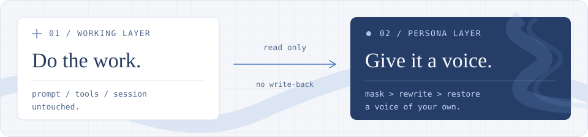

[首页](../README.md) / 架构与边界

# 架构与边界

解释工作层与表达层如何隔离，以及渲染、计数、同步和访问控制的实际约束。本文描述当前实现。

[两层边界](#工作层与表达层) · [状态同步](#状态同步与访问控制) · [运行信息](#过程运行信息) · [使用边界](#使用边界)

---

## 工作层与表达层

工作层照常使用自己的提示词、工具和会话记录；正常转述只读取已经提交的助手汇报，另起一次改写调用。开启过程运行信息后，仅过程转述可主动查询本阶段计数、可确认的工作性质与本会话节奏；可选的静默播报则单独只读观察运行活动。所有表达结果都不回写工作会话。

  

- **先保护技术内容。** 识别到的字面量替换为 `[[n]]`；给模型的历史语气样例也保持打码状态。
- **再校验改写结果。** 模型须明确正常结束（`finish: stop`），再检查标记集合、重复与缺失、长度，以及是否新增代码围栏；通过后才作为最终人格版保存。达到输出上限或缺少结束标记时回落原文，不保存截断的人格版。
- **改写不回灌。** 结果写入插件的 `persona_shell` 存储域，不写回工作会话日志。
- **原文作为底本。** 调用失败、超时或校验不通过时回落原文；超过长度上限、空正文、中断步骤等直接跳过。

这些校验保护的是字面量和输出格式，**不等于逐句事实核验**。提示词要求保留事实、风险和适用条件，但重要结论仍应对照原文；流式显示中的内容也尚未经过最终校验。

用户已经在工作流中看到的实时原文，在等待转述期间保持可读，定稿通过校验后再整体替换。尚未显示过实时原文的步骤仍可显示转述增量；两种展示都保留官方组件、图片、推理区和失败回退，不把半成品写回工作流。

默认开启 `colloquialReports`：普通说明按整段安排语序，允许有限拆分、合并重复措辞或调整先后，长短句自然衔接；关闭后仍按人格转述，句式更贴近原文。步骤顺序、列表符号、标题层级与事实关系保持，结论与条件、风险和证据相邻对应。技术字面、数量、否定、范围、动作时态、工作归属和后续责任保持。汇报专用示例与聊天室示例独立，口语化不新增角色闲聊、额外解释或操作承诺。

单次重新转述始终使用该行保存的原始报告，并保留历史说话者与本次表达要求。它进一步补足原文能确定的主谓关系，将压缩片段讲成完整说明，执行者未知时不补猜；长度校验采用 `max(maxRatio, 1.7)`，提示与实际校验使用同一预算。失败保留旧稿与反馈草稿，不把单次要求自动写成长期偏好。

`persona-expression.js` 为请求生成临时的渠道视图。只有宿主标记为内置、编号与完整卡片均匹配的预设，才使用对应的内置聊天或汇报材料，不按名称或头像推断。自定义卡的顶层字段用于转述，可选 `chat` 提供聊天语气、示例和原始角色参考，不能赋予现实关系、记忆或权限；缺失字段沿用旧卡表达，显式空数组表示不用该项。`persona-chat-profile.js` 做有界投影；`chat.source` 只有启用且身份/有效聊天语气快照匹配时才进入本人聊天系统材料，手动编辑使旧参考失活而不删除原文，其他渠道不读取。`normalizePack` 保存可选材料，不自动迁移旧卡。判断线程只读取公开的聊天语气简述，不接收私有偏好、原设全文或整套示例。准备视图不写存储、不新增模型调用。

生成器的JSONL记录协议与持久卡分开。`parseGeneratedPreset` 检查完整记录及2日常/1工作多轮，程序确定性组装现有卡片并附本次用户原设，结构不完整时拒绝，不用过滤后的残卡或中性默认伪装完整生成。旧 `parseExtractedPreset` 仅保留兼容；生产生成入口不回退接受旧深层响应，也不增加修复模型调用。成功后自动展开同一份可编辑核对草稿，收起与重开不另建状态，不自动启用；性别与外形气质分开核对。

聊天室回复允许自然正文和完整 `messages` JSON 两种入口，由程序统一为持久化气泡；自然正文按空行分泡，需要保留泡内空行、代码围栏或正文以结构保留符开头时，用 JSON 字符串包装。结构化坏 JSON 仍拒绝，不退回正文解释；合法沉默仍须明确的空 `messages`，空流和截断不算沉默。解析器、流式限制和预算保持原样，不增加修复请求或 SDK 未公开的结构化参数；不把正文入口合规冒称为 JSON 合规提升。

默认模型查询与生成共用同一超时和取消范围。切换或编辑人格会清除旧语气样例并取消旧人格的在途转述；卸载时取消转述及人格提取请求，并等待本地请求任务退出，迟到的模型列表不会触发新调用。

## 状态同步与访问控制

报告请求由 `report-request.js` 一次准备有效表达材料、真实来源关系与校验参数；提示渲染和最终检查复用同一结果，原文和回填正文分别保持各自校验域。该准备不读取会话、记忆或模型，不改变保存的人格卡。流式文字和阅读状态只通知页面，报告创建、完成、失败和恢复状态变化才安排报告持久化；阅读结果沿自己的缓存保存。

现在优先使用**官方 Remote 推送**，复用 Gateway 的共享连接，不自建 WebSocket / SSE。连接健康时，不再定期拉取 `/state` 或 `/settings`；能力缺失、打开超时或连接载体无法恢复时，才回退兼容长轮询。

| 通道 | 访问边界 |
| :--- | :--- |
| **HTTP 路由** · `/state`、`/settings`、`/diagnostics` 等 | 默认经过官方 Connection 身份检查；缺少认证服务时默认拒绝访问。 |
| **Remote 推送** · `personaShell/observe` | 使用官方 Gateway 连接身份，并额外限定为 `owner`。正常官方客户端不需要再配置一套账号或 token。 |
| **公开探针** · `/persona-shell/ping` | 免认证；只返回固定结构的运行状态，不含正文、会话 ID、设置或错误详情。 |

- **先快照，后增量。** 每代先发完整状态，再传变化行、删除项与元数据；慢消费者合并为最新状态，不积压逐 token 队列。
- **会话共享订阅。** 同一会话按引用计数共享；额外保留控制订阅，关闭人格后仍能收到重新开启的通知。
- **重连替换底本。** 状态带插件实例 `instanceId` 与实例内 `rev`。新实例可以从更小版本号开始，旧实例的迟到响应不能覆盖新状态；存储就绪或失败会通知启动期间已查看的会话。
- **只重试可恢复的失败。** 认证、业务与协议错误不伪装成兼容性问题。5 秒本地检查负责复查渲染契约与重试可恢复订阅，不重开健康订阅。
- **播报视图有租约。** 仅当前台确实查看且播报开启时，沿流上行续租；异常断连最长 45 秒失效，不同物理流的租约互不撤销。

推送没有持久化事件日志，不向工作会话追加记录。详细错误仍需认证后读取 `/diagnostics`。

## 原文对照的渲染与快照

- 宽窗口下左边是原文、右边是人格版，两边各自滚动。窗口宽度最多 **1100px**，高度最多 **720px / 可用视口的 80%**，始终受窗口边距约束，不会把应用或聊天区撑宽。
- 对照内容区不足 **720px** 时，改为「原文 / 人格版」标签切换。两份正文不重新挂载，同一次对照内各自保留阅读位置；支持左右方向键、Home / End 切换标签。
- 点「关闭」、按 Escape 或点击遮罩退出，焦点回到「origin」按钮。打开时锁住背后页面的滚动，关闭或卸载时恢复之前的滚动设置；聊天正文与思考面板不重挂载。
- 展示的是**点击当时的只读快照**，之后到达的状态更新不会悄悄替换窗口里的文本；关闭再打开才读取最新版本。两份快照仍由官方 Markdown 组件渲染，不另开模型调用、不写回会话日志。
- 这是整条汇报并排阅读，不是逐句语义对齐或自动差异高亮。图片块、思考面板等保留在主消息中，不在对照窗口复制；正文中的 Markdown 图片仍由官方 Markdown 处理。

正常情况下复用官方 `Modal`，由宿主管理遮罩、焦点循环和 Escape；缺少该组件的旧宿主尝试浏览器原生模态对话框。官方 Markdown 组件不可用时，两边明确降级为保留换行的纯文本，不伪造 Markdown 渲染。

## 措辞变化评估

这个数值衡量**措辞变化**，不是“语义漂移概率”。它在本地对打码后的正文计算双向字符二元组差异与相对长度变化，取两者较大值；因此新增或删减文字也计入，大片不变的代码不会稀释正文分数。默认阈值只是初始经验值，未经语义准确率校准。否定等信号是中英文句式启发式，可能误报（如「并不复杂」变成「很简单」），也会漏掉用词相似但顺序或意思改变的内容。

数字变化和明确、单次出现的工作谓词已/未状态反转可独立提示对照，不受总体措辞分数稀释。后者保存在可选的 `criticalReasons` 中；重复谓词、条件和推测不猜测对应关系，单纯词频变化也不自动提升为强信号。它们仍是启发式提示，不自动拒绝结果或认定事实错误。

评估结果作为独立版本的 `row.review` 随改写保存在插件域，绑定原文和人格版的本地指纹；若当前文本不匹配，不展示这份旧评估的提示。改阈值或开关只重新决定是否显示，不重新调用模型。没有评估字段的旧记录、未知版本记录保持**未评估**，不自动补算。**没有标记不等于内容安全或语义一致**，每轮原有的「origin」按钮仍保留。

第一版按**整条汇报**评估与标记，不做逐句锚点或句末标注；流式内容不展示该提示，依然可能在最终校验前被读到。原有字面量/围栏/长度校验的失败回落逻辑不变，提示信号本身也不作为拒绝改写的依据。

## 过程运行信息

过程转述在开关开启时可获得只读函数 `get_tool_usage()`。使用入口与独立补充的显示规则见[使用指南](./guide.md#过程运行信息)。

- **只算两个阶段汇报之间的新活动。** 第一段从本轮开始计数；每次收到主助手已提交、带工具调用的阶段汇报，就立即冻结该区间并开启下一区间。分界以原始汇报事件为准，不等待模型查询或转述完成；没有查询、转述失败、超长跳过，都不会让旧计数累加到下一次。
- **调用与返回分别去重。** 相同调用 ID 的发起和结果各记一次，重复事件不会再次入账。较早发起、在下一区间才返回的结果只增加新区间的返回数，另用 `earlier_returns` 标明来源，不增加新调用数。查询只读取固定快照，不清零、不消费，也不重新统计。
- **只传分类与标量。** `search / read / edit / execute / other` 对应查找、读取、修改、执行和其他；每类只包含 `calls / returned / errors / earlier_returns`。未知工具归入其他，不分析工具参数或输出正文，也不根据名字猜测是否测试通过、搜索命中或任务成功。统计的是宿主实际发布的工具事件，不展开工具内部隐藏的操作；额外的工作性质和节奏字段见下表。
- **观测不全就明确缺失。** 中途开启、插件重载、收到无法关联的返回或超过本地跟踪上限时，受影响区间返回 `available: false`，不给不完整的工具计数或工作性质；独立可知的本地小时等节奏信息仍可参考。下一次完整区间可恢复；容量已耗尽则等待下一轮。实时计数、去重 ID 和轮间边界不持久化、不补算历史；已展示补充绑定的只读依据随结果保存，恢复后不拿它继续计数。
- **函数只属于过程转述。** 关闭开关时既不采集，也不给函数或暗中附带计数。最终汇报、只改最终汇报的模式、子代理和静默播报均不获得这个函数；所有获得该函数的过程转述都不进入后续口吻样例，避免统计经样例进入最终汇报。函数不能调用工作线程的工具、读取其他会话或改变任务。
- **最多一次查询、一次续接。** 模型可以不查；若查询，同一次转述最多增加一次模型续接，两次请求共用原有超时。非法参数、未知函数、重复调用、协议不兼容或超时会回落原文，不循环追问。关闭开关会取消在途的统计转述。开关和已经展示的独立补充随插件结果保存，补充不回写主会话。

### 字段与未知值

| 元数据 | 含义与边界 |
| :--- | :--- |
| `work_nature.is_read_only` | `true` 表示本区间观察到的都是查找/读取类工具；`false` 表示有修改类工具活动，不保证修改成功。命令、未知工具或更早发起但尚未返回的修改操作会使结论不完整，此时为 `null`。 |
| `work_nature.files_touched` | 本区间**确认发生变更的不同文件数**，按成功结果归属区间；同一文件多次修改只计一个，下一段重新统计。仅支持官方文件工具 `edit / write` 的结果元数据，在本地将规范路径转为不透明标识去重，不读取 diff 正文，也不发送路径。缺失元数据、失败、未返回的修改或不透明命令使数量无法确认时为 `null`；创建空文件计一个，未改变内容的覆盖写入不计。 |
| `work_nature.ran_destructive_cmd` | 三态字段：`null` 表示无法判断；可确认本区间没有命令类或未知活动时为 `false`。当前 SDK 没有统一的命令风险元数据，尚无可靠的 `true` 来源，因此不靠匹配命令字符串猜测危险操作。它不是安全检查或批准依据。 |
| `session_pacing.session_turn_count` | 本会话由宿主提供的运行轮次序号，重复事件不额外加一；不等于人工消息条数，也不能证明一直在调试同一问题。边界未观察到时为 `null`。 |
| `session_pacing.local_hour` | 冻结快照时运行环境的本地小时，范围 `0..23`；Desktop 通常与系统时间一致，远程 Web 部署可能与读者时区不同。只给小时，不传精确时间或时区标识。 |
| `session_pacing.idle_minutes` | **上一轮结束 → 本轮开始**的间隔，精度 0.1 分钟，同一轮保持不变。不会把上一轮执行任务的时间算进去；用单调时钟计算，系统校时不改变间隔。首次观察、缺少结束边界、中间漏轮、切换开关或重载后为 `null`。 |
| `session_pacing.is_first_report` | 是否本轮第一段原始阶段汇报；按源事件推进，不按查询推进。提示人设只在首段回应轮间间隔，避免每段都“欢迎回来”。 |

这些信息只作为当前人设的语气参考，不根据轮数或夜深强制变得疲惫、缩短正文或提醒休息，也不据此断言用户刚吃饭、睡醒、摸鱼或持续工作了多久。没有跨会话疲劳画像，不加入长期风格记忆；关闭开关后停止观察并清理边界状态。

格式和部分明显的不实表述会被本地规则拦下，**这仍不是语义核验**。模型看到统计后仍可能影响这一段的表达，重要信息应对照原文；最终汇报不使用这条统计路径或它生成的语气样例。

## 静默播报的观测与生命周期

静默播报是额外生成的旁路内容，只依据可观察活动；不写回主会话，也不成为后续转述样例。

- **依据是什么：** 只观察本轮模型请求开始/结束、工具发起/返回/错误计数，以及是否仍处于运行状态。不会把完整会话、工具名称/参数/输出、代码、路径或思考正文发给播报模型。工具返回不等于工作成功，运行状态也不能证明任务正在有效推进。
- **怎么说：** 沿用转述模型路由，单独进行一次无工具、无会话历史的短调用，以人格卡的口吻播报一两句。界面直接添加固定前缀 **`◈`**，不是让模型生成；悬停标记可看到本地汇总的观测依据。它与改写变化提示 **`※`** 含义不同。
- **怎么显示：** 显示在输入区上方的独立扩展槽，仅保留最新一条，作为纯文本而非 Markdown；不是伪造的助手消息。主模型开始输出新正文、观测事实发生变化、当前轮结束或用户关闭功能后收起。不会重挂载主正文、思考面板或占用其他插件的 dock 条目。
- **何时调用：** 从本轮开始或最近一次主模型正文增量计算静默时长，工具活动和思考增量不会重置这个时钟。阈值达到后才考虑播报；单纯多等了几分钟、更多思考 token 都不算新事实，同一组观测最多尝试一次。每轮最多 **3 次**额外调用，全插件同时最多一个播报请求，单次最多 **15 秒**、请求输出预算 **512 tokens**。
- **何时不调用：** 主会话没有运行、子代理会话、等待用户批准/回答、总开关或会话开关关闭、设置尚未恢复、宿主缺少可确认的实时运行状态时不播报。通过只读事件和原样透传的问答等待监听器判断，不向主 Agent 发指令、回答问题或改变工具决策。
- **切走与重启：** 只为仍有有效前台查看租约的会话生成，页面隐藏、切换会话或卸载时主动释放；异常断连时租约最长 **45 秒**到期。推送模式只在播报开启且确有前台查看时，每 **15 秒**沿同一条流上行续租；兼容模式仍由长轮询续期。不同连接使用独立租约，旧连接清理不会撤销新连接。设置持久化，但播报内容、计数和轮次状态**不持久化**，重载不补发历史播报。

网络失败或超时静默跳过，不为相同事实立即重试；格式违规、明显的完成承诺或新造数字等会退回本地保守文案。调用过程中若正文恢复、事实变化、人格切换或本轮结束，会取消并丢弃过时结果。

## 结构化记忆与接力基础

结构化记忆作为独立版本的记录保存在现有插件存储域，与旧统计 profile 分开。用户明确的表达偏好可以本地及时记录，模型整理结果先进入候选；来源、作用范围和条目版本参与更新与筛选。同一消息的序号用于去重，后台批次按同一会话和人格组织。

更正、撤销和采用核对单与条目保存在同一有界记录中。更正产生替代记录，撤销只使目标失效；二者保留独立的原话依据，并固定目标范围、版本和有效期。后台只能提出建议，所有确认交互在设置页完成。所有者修改先暂存并写入存储，再启用；与并发清空或观察冲突时恢复最新副本，不让失败保存改变提示词。

所有表达渠道共用筛选和提示约束；静默播报只接收允许使用的偏好内容及运行观测。使用记录与记忆条目分开持久化，不推进条目版本或后台批次，不干扰更正事务。只有实际进入 SDK 模型流调用才标为已提供，能力查询失败保持未发出；函数续接和兼容重试共用一次逻辑记录。记录不保存正文，清空后退休旧请求句柄，迟到完成不能恢复旧记录。设置页通过当前编号和版本解析内容，聊天状态流不增加使用记录字段。

正文只选取表达偏好和互动约定，作为引用数据提供给转述模型。共同经历和会话情况保留为管理层与后续交互的基础；接力记录使用发送角色、接收角色和会话绑定的显式引用，不自动导出人格私有记忆。完整的数据边界、删除规则与接口见[记忆与接力基础](./memory.md)。

## 会话人格与反馈

内置角色的公开身份与有向关系集中在 `lib/character-roster.js`，由精确内置 ID 与 `builtin: true` 共同识别，不能通过显示名、头像或另存来源获得身份。聊天仅注入当前发言者到在场内置成员的关系；统一判断可读取在场内置成员间的公共关系。输出白名单再次投影，防止把完整人格卡、私有偏好或用户字段带入。身份资料在聊天中优先于错误历史和称呼偏好，既不改写原始记录，也不以全局字符串替换修补输出。自定义人格只识别他人的公开身份，不继承内置关系。设定说明及素材出处见[内置人物关系](./characters.md)。

公开资料中的 `defaultOutfit` 是默认造型，供当前房间的内置角色相互理解；用户明示本幕换装时优先承接，不把默认服装当永久身份或要求证明换过。参考图只提炼有界文字，不打包原图，也不据造型推断年龄、用户身份或现实观察。它不改变人格卡、正式转述和长期记忆。

聊天室提供实验性的短程场景参考：共同想象或角色扮演时，已有判断调用可在原选择行后附一条 `SCENE | 参考方向`，也可省略。首行仍先核对原话、作者与发言资格，只有有效下一位且明确不取工作正文时接受；方向最长240字符，不是台词、已成立事实、用户反馈或执行许可。附带行格式错误或不满足选择条件时，整个判断按原失败路径处理，不截取修补、不增加模型调用。

Host在准备该角色时将参考绑定当前房间、清空代次、来源范围、用户轮、角色与真实公共引用位置；actor侧再对照实际回应目标和当前可见时间线。引用失效、对象不符、工作选择不明或需要工作正文时，不提供参考，沿普通接话。方向仅在当次请求中使用，不保存到房间、responsePlan或长期记忆；重试与重启不恢复。后续判断依据实际已交付正文重新选择，用户改题可以随时打断原方向。模型可以不产生或不采用参考，不保证每轮触发或更连贯。

角色消息区从工作页按钮打开，无单独启用开关；全局管理一个浮窗，内部按独立房间组织记录、成员、接收人和来源选择。存储结构为 `version: 3`，不迁移未发布的旧开发格式。房间维护普通记录版本和配置版本，消息完成不会使无关的成员编辑失效；名称、成员与多选目标仍采用持久化确认和冲突检查。

用户原话先进入持久化输入缓冲，再保存为 `phase: anchor` 的用户专用锚点。它保留有序 `recipients`、分段 `userParts` 和发送时成员快照，不算角色回复或未读。判断线程逐次追加实际发言，`directedPlanId` 保证幂等；每份回复的 `recipientId / attemptId / emittedOrder` 独立，公共时间线与下一轮历史保持同序。

`chat-room-director` 共用资料相关性和下一位选择，读取公开时间线、公开人格关系和来源名称，不接触私有记忆。普通候选由程序等级和冷却确定；独立同伴机会还要验证实际公开点名依据。每次只准备一个人格请求，在执行前读取最新现场和本人的表达偏好。判断最高每五秒一次，相同消息与相同候选资格不重复调用，不产生常驻主动聊天。

每个人格的实际模型消息按本人视角投影：自己已经完成的公开回复使用 `assistant`，真人和其他成员使用带作者的外部消息。正文沿一条时间线提供一次，末尾的临时控制资料只保留回应目标、未处理事件、引用位置与归属；引用、讨论依据和书签复用同一原话位置。重建的历史标明未知历史模型来源，不冒充当前模型，不携带提供方隐藏重放状态。其他人格采用外部消息角色并不授予真人指令权限，私有偏好仍只进入本人提示词。

公开消息更新与接话资格分开：未首答的用户入口、真实定向回应和一次独立点名机会各自核对。普通同伴发言可以被听见，却不会自动重新唤起全房。判断结果使用绑定快照的有限选项协议；工作来源和依据也由本地选项定位，不要求模型生成路由对象或抄写长原话。无效结果保留为失败，不当作沉默，也不发起隐藏修复调用。

每个用户周期按有序选择初始化等级：广播全员零级，主要零级、次要一级、未选中二级。普通成功回复升级，一级五秒、二级十秒、三级排除；每人格另有一次独立同伴回应机会。只有新用户轮可重置，重启由已提交成功回复恢复消耗。八人周期最多三十二份完整回复；错误不伪装成成功发言，但自动重试停止。

SSE 只包含实际角色尝试，不给用户锚点造临时帧。单席重试保留其他成功者，引用位置不变。控制器覆盖判断、冷却和发言阶段，旧代号、旧范围和跨房间迟到请求不能写回。细节见[聊天室统一调度](./chat-scheduling.md)。

更换勾选只影响下次发送，不取消原请求，也不重命名旧回复；移除正在发言或排队的成员会退休该槽位。中途新加入者从下一条用户消息开始参与旁听。所有模型请求仍由用户本条消息及其有限接话触发，打开窗口或选择角色不调用模型；没有持续自行聊天的循环。可选快捷回复仍只产生一次候选请求，不注入角色偏好、不写历史，点选仅填入输入框。

首次点击后才恢复房间目录，进入某个房间后才初始化其只读来源管理器与查看租约；切换工作页不重建窗口。来源标识随房间保存，正文缓存与焦点分数只在内存中保留，未选房间无常驻扫描。未使用项目只列文件夹名称；选中会话通过被动 SessionQuery 读取原始事件。来源选择版本绑定聊天轮次，范围变更只退休该房间旧请求，历史和快捷回复只取相同范围的轮次。相关提醒仅复制有界事件元数据，不自动读取正文或生成角色发言。详见[参考来源与工作焦点](./chat-context.md)。

浮窗不接管官方工作渲染，不新增工作区主动消息。头像独立于语气卡，仅暴露本地版本地址；成员缩略图与组合头像实时取当前展示资料，不进入模型。工作流转交尚未接入。接口、容量与关闭行为见[角色消息区](./role-chat.md)。

用户头像采用独立的版本化资料记录，供设置页与消息窗口共用，串行提交后广播已确认版本；迟到快照保留更新的头像。聊天清空推进持久化 `epoch`，阻止旧的空房间发送和恰好重用旧版本号的清空、停止请求。联系人列表只复制姓名等元数据，不在每次读取时复制所有聊天正文。

可选的用户称呼保存在同一资料记录中，默认空串，单独更新不改变头像。称呼只以 JSON 文字数据进入实际发言角色的提示词，不改写角色卡、消息作者或原话，不提供给判断线程、正式汇报或指令整理，也不写入长期记忆。资料读取和修改本身不调用模型。

可选 `userGender` 也保存在该版本化资料中，缺失或无效的旧值恢复为 `unset`，新写入只接受 `unset / female / male / none`，与称呼和头像共用持久化提交与 revision 冲突检查。自定义角色的可选性别是 `chat.gender`，不进入转述投影；内置聊天投影固定为女性。`chat-gender.js` 仅为实际发言角色准备性别与相处分寸，不提供给公共判断线程、进展/报告、指令整理或记忆提炼；不改变调度、额度或权限。设置修改只影响之后准备的请求，不改写在途输出或历史。

预设写入在存储可用时等待完成再更新当前选择，写操作互斥；普通失败尝试补偿预设与活动指针。底层存储封装没有跨键事务，补偿不等同于断电原子性。无存储旧宿主保留显式的临时人格模式；头像写入要求存储就绪。

全局开关与模型设置按接受顺序写入，完成后才回执“已保存”；退出插件会等待已接受的写入。落盘失败时，已发生的即时开关效果仍保留，设置页明确显示当前生效但保存失败，可重试保存当前有效设置。启动恢复前的修改先覆盖内存并在恢复后合并写入，回执说明存储尚未就绪；无存储时明确仅本次生效。它们都不等同于持久化成功，失败也不表示已回滚所有即时效果。

会话控制记录与全局默认分离；有效人格决定提示词、记忆选择和署名，有效转述范围决定来源筛选。切换按会话取消在途请求并清除语气样例，切换全局默认只影响继承它的会话。历史结果保存生成时的署名，不按当前人格重新标注。

手动接力与会话选择在同一记录中串行持久化，以版本比较拒绝旧页面写入。接力只在下一份新的合格原文到达时消费一次；写入失败不消费也不调用模型。单次反馈在暂存结果上重写同一原文，通过校验后替换；失败或角色切换取消时保留旧的可读正文。反馈偏好先暂存、持久化再启用，与并发清空冲突时清空优先。接口、缓存范围与限制见[会话人格与手动接力](./conversations.md)。

## 使用边界

以下是当前实现的取舍，不是打开某个设置就能全部消除的限制。

- **依赖特定官方渲染契约。** 插件从公开槽注册表读取仍然存活的官方 `AssistantNodeView`，复用其组件、语言与展示策略注入，只替换显示副本中的一个 `text` 块；不会修改会话节点、`finalNode` 或其他块。思考正文和图片通过官方公开 Content Factory 显示，不复制 Markdown、思考面板或图库实现。底部全局运行状态属于官方 `ChatFlow`，本插件不接管。
- **遇到不兼容就保留官方显示。** 官方契约变化、默认子槽被其他插件扩展、同一助手槽存在其他接管者、缺少所需 Factory 时，撤销本插件的助手注册；设置页说明人格显示已暂停。渲染异常也会退出，不会反复重装失败的组件；排障后关闭再打开可重试。Factory 的静默变化最迟在下一次 5 秒本地检查时重新检查。
- **目前只替换单个正文块。** 一步里有多个 `text` 块时不猜测它们的拼接与拆分关系，整步显示官方原文；运行中、中断、没有正文以及 reasoning 分区也不替换。混合步骤中的图片与思考留在主正文中，「原文」预览只展示文本，避免重复图库和思考面板。
- **不另建正文布局。** 主消息保持官方根节点、类名与子槽定位锚点，不加人格正文外框；「原文」打开页面级模态窗口，变化提示保留轻量预览。对照窗口打开时暂时隐藏轻量提示，避免它和模态窗口争抢 Escape。主正文不重挂载，已展开的思考面板保持状态。主题只改样式时沿用官方结构；主题若替换渲染器，则按冲突退出，不承诺任意第三方主题兼容。
- **注册仍是页级。** 当前会话关闭时会释放整页接管；每行也检查各自的会话开关，避免在多会话展示中错误替换已关闭会话。尚未完整验证多会话并排场景。
- **额外模型调用。** 符合条件的每条汇报都会发起转述调用；叙述文本会发送给所选模型提供方，并非纯本地处理。
- **打码仍是启发式规则。** 按规则识别命令、路径、URL、围栏等内容，不保证覆盖所有字面量。未识别的片段仍可能随正文发送给所选模型，或被改写。
- **隔离不等于没有间接反馈。** 插件不把人格版写回工作会话，但用户读到人格版后的下一轮输入仍会原样进入主线程。措辞变化提示不是逐句语义核验，不能消除这条人类反馈路径。
- **路由默认要求认证。** HTTP 依赖 Connection 检查，Remote 另有 owner 限制；特殊部署的退出选项见[配置参考](./configuration.md#路由认证)。
- **验证范围有限。** 尚未系统验证长会话性能、多会话并发与真实 Desktop 下的极端时序；离线测试不能替代这些验证。

---

[使用指南](./guide.md) · [配置参考](./configuration.md) · [开发指南](./development.md) · [返回首页](../README.md)
